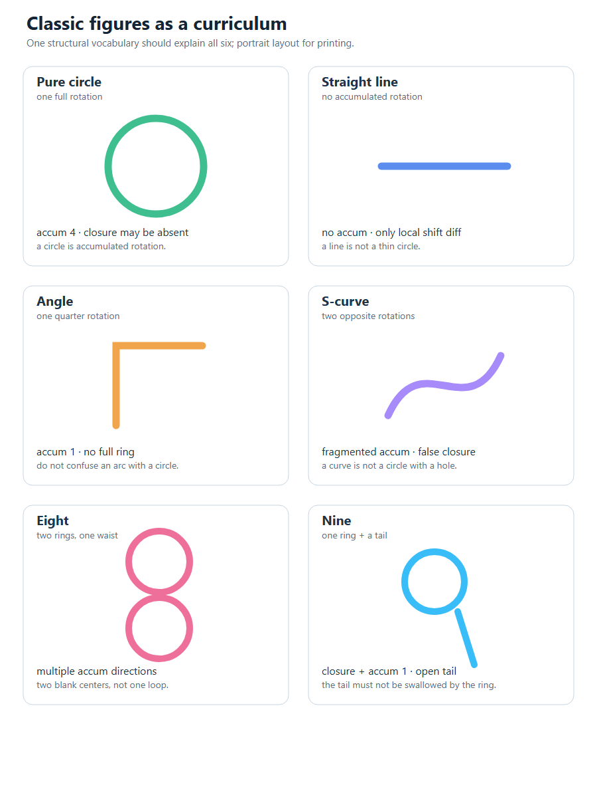
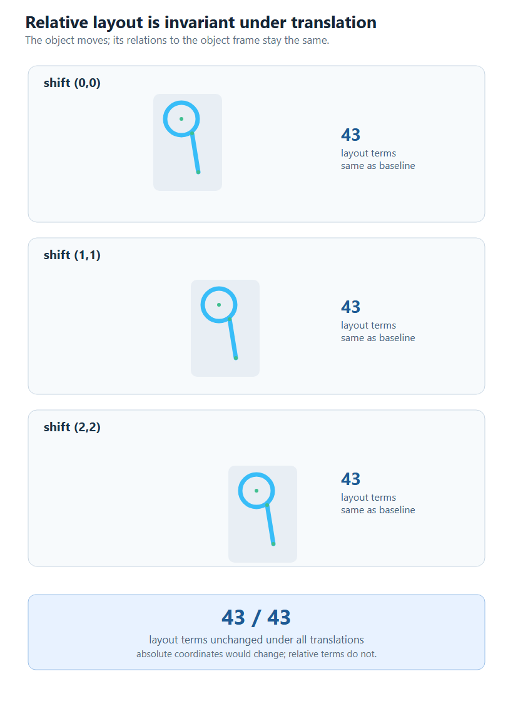

# 操作差与相对布局：一个基于 NAL 的结构词项识别实验

**莫克陶**

## 给非专业读者的导读

对哲学、教育学、心理学等领域的读者，本文的核心问题可以概括为：

> 认对数字只是结果；本文更关心认对的理由能否写成一组可检查的关系。

一个日常比喻：看手写的“8”，人记住的是“上面一个圈，下面一个圈，中间收窄”，无需背每个像素；看“9”，记住的是“上面一个圈，下面一条尾巴”。本文让计算机也走这条路线：先把亮点圈成小块，再记录小块之间的走法、转弯、重复、闭合和相对位置，最后拿这些关系和记忆中的数字比较。这些关系在系统中叫“词项”，可以先把它理解成“一句可检查的描述”。NAL（Non-Axiomatic Logic，非公理逻辑）给每个判断附上一个“有多相信”的程度；新证据来了可以修正。

| 读者 | 建议先读 |
|---|---|
| 初中生 / 非专业读者 | 本导读、图 1、4.2 节、第 6 节 |
| 哲学 / 心理学 | 本导读、第 1 节、5.1 节、5.4 节 |
| 教育学 | 本导读、3.2 节的例子、5.4 节 |
| 技术读者 | 全文 |

## 摘要

本文报告一个手写数字识别实验：系统先把图像中的亮点圈成一些可能是圆形的小块，再记录这些小块怎么走、怎么转弯、哪里重复、哪里回到原处，以及它们之间的相对位置；最后用这些关系与记忆中的数字比较。它不保存像素模板。识别由 NAL（Non-Axiomatic Logic，非公理逻辑；一种允许不确定、可修正的判断逻辑）完成比较、修订和提问；系统没有使用常见的分类器（即直接由图像给出标签的模型）。在 200 张测试样本上取得 81.0%；经典图形上的相对位置在平移后保持不变。本文也报告数字 8 与 9 的混淆及当前瓶颈，并将自身定位为一个独立的工程实验，不主张新的 NAL 视觉理论。

**关键词**：非公理推理；NARS；结构词项；操作差；相对布局；视觉识别


## 1. 引言

手写数字识别通常被表述为像素到类别的映射：输入一张图，输出一个数字。深度模型在该任务上已取得很高精度，但其内部表示与判断依据往往难以直接解释。对于通用智能研究，更关键的问题是“识别能否建立在可复用、可推理的概念之上”；再高的百分点并非本文目标。

已有 NAL 视觉研究提供了重要参照：一类工作把边缘/曲线等视觉概念组织成概念网络，以归因解释观察、以归纳更新原型 [9]。本文与这条路线共享“视觉可以纳入 NAL”的前提；研究对象则是**操作差、累计转角、恒常、闭合和相对布局**这组结构词项能否支持类别比较，不复用边缘/曲线视觉原型库。本文不主张新的 NAL 视觉理论；它是一个独立的工程实验。

在此背景下，本文研究一个较小但可检验的问题：**能否用一组结构词项代替像素特征，并让 NAL 推理完成识别？** 这里的“结构”指图像中初步圈出的圆形小块、相邻小块之间的一步、连续两步之间的差异、累计旋转、重复模式、首尾闭合和相对位置等可跨样本复用的关系；它不涉及把笔画拟合成矢量图形，也不涉及用卷积特征替代像素。这里的“初步”意味着：它由若干相邻亮点组成，可能并不是真正的圆，也不等于概念。为便于阅读，后文把这种“初步圈出的圆形小块”简称为 loop，把“两个小块之间的一步”简称为 Shift；不熟悉这些名字的读者可以先按这两个日常描述理解。

举一个具体例子：对“8”，系统记录的是“上下各有一个闭合的圈，两个圈之间收窄”，不记录“第几行第几列是黑的”；对“9”，记录的是“上面一个圈，下面一条开放的尾巴”。这些关系都可以用日常语言说出来，也可以被检查。

需要先澄清一个常见说法。将本工作描述为“从像素识别转为矢量识别”并不准确：系统没有做 SVG 曲线拟合或几何模板匹配，像素也没有被丢弃。更准确的描述是：

```text
像素 → 结构关系 → 词项 → NAL 推理 → 答案
```

像素只作为感知通道的输入；进入记忆和推理的是结构关系。本文的贡献可概括为：

1. 给出一组以操作差、累计、恒常、闭合和相对布局为主的结构词项，区别于边缘/曲线视觉原型；
2. 用 `∩` 复合表达“圈 + 中心空白”等整体概念，并在 NAL-3 中实现交集的引入与消去；
3. 在 200 张手写数字测试样本上验证“无分类器、仅 NAL”的识别路径；
4. 报告失败案例，指出单观察集/词项袋是当前的主要瓶颈。

## 2. 相关工作

### 2.1 NARS 与知觉

Pei Wang 提出的 NARS 以“知识和资源不足下的适应能力”（AIKR）为核心，强调在不确定、不完整经验下进行推理，而不是用固定分类器拟合数据 [1]。在 NARS 的知觉研究中，感觉输入可以进入同一套经验与推理框架；知觉不是与推理割裂的视觉模块。相关工作报告了感觉运动通道、事件缓冲和“自下而上压缩 + 自上而下预期”的机制 [2–5]。

OpenNARS/ONA 社区进一步把事件缓冲、传感器运动等机制做成可运行系统；NARS-Python 也提供了知觉实验平台 [6–8]。这些工作为本文提供了框架，但本文不声称实现了完整的 NARS 知觉架构。

### 2.2 一条相近的 NAL 视觉路线

文献 [9] 的 *Vision by Logic: A Naïve Visual Recognition Model with Non-axiomatic Logic* 是这条路线的一个代表。该工作把“物体”理解为部件相对位置关系的总和，用边缘/曲线等概念逐层组成概念网络；识别被建模为用已知原型解释观察的归因推理，学习则用归纳推理更新原型。

### 2.3 两种取舍的对照

| 维度 | 已有路线 [9] | 本文 |
|---|---|---|
| 视觉单元 | 边缘、曲线、物体原型 | 初步圆形小块、操作差、累计、恒常、闭合、相对布局 |
| 识别 | 用原型解释观察（归因） | 类别词项的比较与修订 |
| 学习 | 归纳更新视觉原型 | 类内词项频率统计 |
| 目标 | 统一的 NAL 视觉模型 | 独立的结构词项实验与失败分析 |

两者共享“视觉可以纳入 NAL”的前提，但表示单位与识别路径不同：前者以视觉原型解释观察，本文以操作差和相对布局做类别比较。两种取舍可以互补；本文报告另一组结构词项在同一个手写数字任务上的可实现性与边界。
## 3. 方法

### 3.1 感知通道与推理层

系统分为两层。

**感知通道层**负责把 16×16 像素变成初步的区域提议：`growDiscs` 从活跃像素长出圆形小块（loop）；两个 loop 之间的一步记为 Shift。该层允许几何计算，但它只提出提议，不决定类别。

**推理层**只看到结构词项。记忆中的类别概念表示为：

```text
digit_d → [term_1, term_2, ...]
```

每个词项带频率 `f` 与置信度 `c`。识别时，当前帧也表示为 `frame → [term...]`，通过 NAL 比较与修订得到 `frame ↔ digit_d`，取期望最高者作为答案。系统中没有 softmax、kNN、决策树或模板匹配。

### 3.2 结构词项

本文使用的词项可分为五类：

- **loop**：初步圆形小块的数量、大小、填充、链长；
- **Shift**：相邻 loop 的一步，含起点、方向、步长；
- **操作差**：连续两个 Shift 的方向/步长差，按相对感受野面积分为 `big/small_shift_diff_*`；
- **累计与恒常**：一条链上的累计转角 `shift_diff_accum_*`；连续同向、步长相近的 `const_low/high`；首尾回到原处的 `closure`；
- **相对布局**：loop 在物体框 4×4 中的区域，以及 loop 之间的方向、距离、大小比和重叠关系。

把上述词项翻译成日常语言：

| 词项 | 日常意思 |
|---|---|
| loop | 初步圈出的圆形小块 |
| Shift | 从小块 A 走到小块 B 的一步 |
| 操作差 | 连续两步之间，方向或步长变了多少 |
| 累计转角 | 一路的转弯加起来；4 个四分之一圈约等于一整圈 |
| 恒常 | 连续几步的方向、步长都差不多 |
| 闭合 | 走一圈回到起点 |
| 相对布局 | 小块在整体里的方位和距离，不是绝对坐标 |

其中 `shift_diff_accum_l_4` 表示累计约四个四分之一圈，即约一整圈；`big_shift_diff_r_1` 表示一次较大感受野面积上的右向操作差，步长比处于第 1 档。它们都是关系词项，不是像素坐标。

### 3.3 `∩` 复合与整体概念

“圈 ∩ 空”是 NAL-3 的交集复合，并非新的原子词项：

```text
∩([shift_diff_accum_*], [center_blank], [const_low/high])
```

`center_blank` 只作为复合词项的成分，不是独立类别词项，也没有 flood fill 或找洞算法。核心里同时实现了交集的引入与消去：

```text
M → T1, M → T2  ⇒  M → (T1 ∩ T2)
(A ∩ B) → A,  (A ∩ B) → B
```

这样，“圈 + 中心空白”可以由部件观察构造，也可以被分解检查，而不是由感知层硬编码为一个标签。

### 3.4 相对布局

布局词项不存储绝对坐标，而存储相对于物体框/感受野的关系。例如：

```text
这个 loop 在物体框的左上
这个 loop 在另一个 loop 的右边
两个 loop 相距几个半径
```

因此，物体整体平移时，只要内部相对关系不变，布局词项应保持不变。第 4 节给出验证。

## 4. 实验

### 4.1 设置

使用 16×16 手写数字数据；每类 80 张训练、20 张测试，共 200 张测试样本。结构词表由训练集统计得到；识别阶段只做 NAL 比较、修订和问句。除结构词项外，不使用像素特征或分类器。

### 4.2 结果

| 指标 | 结果 |
|---|---|
| 测试正确率 | **81.0%（162/200）** |
| 结构词项 | 226 种 / 2260 条信念 |
| 记忆体积 | 455.0 KB JSON / 199.3 KB 二进制 |
| 平移 (1,0)/(0,1)/(1,1)/(2,2) | 80.0 / 79.0 / 78.0 / 75.5% |
| 训练 / 测试时间 | 0.5 s / 3.7 s |

图 2 给出用于 curriculum 的经典图形。纯圆主要表现为累计约一整圈；直线没有累计；角只有 1/4 圈；S 形出现碎片化累计；8 有多个方向的累计和两个空白中心；9 是一个闭合加一个 1/4 累计和一个开放尾。它们只作结构词项的可解释参照，并不作为训练类别。



图 3 给出相对布局的平移验证：同一经典 9 平移 0/1/2 格后，43 个布局词项全部一致。绝对坐标会改变，相对关系不改变。



### 4.3 失败分析

原型仍有明显错误。8 与 9 的混淆最典型：在样本 #8040 上，报告已经能显示包含两个闭合块的链级划分，但分类仍给出 9。进一步实验表明，把“双环”“弱边环”“闭合块数”直接作为新词项加入词项袋，都会使准确率下降到 80% 左右。

问题出在识别只接受**一个词项袋**：划分/整体解释没有作为独立观察进入类别比较。多观察集的合并机制已经实现，但从同一全局词项袋切出的子集无法产生真正不同的解释。这是本文当前的主要限制，也是后续工作的起点。

## 5. 讨论

### 5.1 与已有工作、矢量识别的区别

与文献 [9] 的视觉原型路线相比，两者都使用 NAL，都不训练端到端分类器，但表示单位不同：该路线以边缘/曲线等视觉原型解释观察，本文以操作差、累计、恒常、闭合和相对布局组成类别词项。本文不复用该路线的视觉原型库，也不把“圆/边缘”写成新的原子概念；因此，本文是对另一组结构词项的独立检验，而不是对该路线的替代或否定。

本文的方法也不是矢量图形识别。矢量方法通常把笔画拟合成曲线/多边形，再以几何参数匹配；本文保留的是结构与关系，且识别由 NAL 完成。更合适的称法是**结构词项识别**：词项是可复用的关系，而不是坐标或模板。

对非 AI 读者，81.0% 只是结果；本文的价值来自一个可检查的中间层：对哲学，它把“意义”操作化为关系与证据，但不声称等于人类语义；对心理学，它提供一个可外部检查的假设，并不充当大脑模型；对教育，它把“为什么是这个答案”拆成可讨论的步骤，可以作为一种课堂分析材料。这些只是可能的意义，尚未经过本文验证。

### 5.2 本文的贡献（相对于该路线）

1. **记忆单位是结构词项，而不是边缘/曲线原型**：存 loop、Shift、操作差、恒常、闭合、布局；类别侧只存“数字 → 词项”的频率。
2. **识别由 NAL 比较/修订完成**：没有 softmax/kNN/树模型，也没有用视觉原型做归因解释。
3. **操作差成为一等关系**：圆由累计转角得到，而不是模板匹配；恒常是重复的操作模式。
4. **`∩` 复合承载“求同/整体”**：`圈 ∩ 空` 由 NAL-3 构造和分解，不是“洞”标签。
5. **AIKR 的小数据路线与失败分析**：每类 80 张；报告数字 8 与 9 的混淆和单观察集瓶颈，而不是只报告成功。

### 5.3 四个常见误解

- **这是深度学习吗？** 不是。没有神经网络，也没有训练出来的分类器；识别由 NAL 的比较、修订和问句完成。
- **这是把图像变成矢量吗？** 不是。没有曲线拟合或几何模板匹配；保留下来的是关系词项。
- **这是人脑视觉模型吗？** 不是。它是一个工程类比，不声称复制视觉皮层或人类概念。
- **81.0% 有竞争力吗？** 本文不以 MNIST 最优为目标；它检验的是“结构词项 + NAL”能否跑通、在哪里失败。

### 5.4 局限

- 输入只有 16×16，结构词表是人工设计的；
- 81.0% 不是 MNIST 最优结果，也不证明通用视觉；
- 尚未实现完整的事件缓冲、自上而下预期和主动感知闭环；
- 数字 8 与 9 等混淆样本仍失败；单观察集/词项袋是已定位的瓶颈；
- “概念”在这里是操作性的结构词项，不等同于人类概念。

## 6. 结论

本文给出一个可运行的实验：把像素经感知通道变成初步的 loop/Shift 提议，再把操作差、累计、恒常、闭合和相对布局写成词项，由 NAL 完成识别。它在 200 张手写数字上取得 81.0%，且相对布局对平移保持不变。结果说明“结构词项 + NAL 推理”的路线可以跑通；但数字 8 与 9 的混淆也说明，单观察集/词项袋无法承担多划分解释。相对于该视觉原型路线，本文检验的是另一组以操作差和相对布局为中心的词项；下一步需要让不同划分生成真正不同的观察集，再由 NAL 证据竞争，而不是继续向同一词项袋添加专用词项。

## 参考文献

1. Pei Wang. *Non-Axiomatic Reasoning System: Exploring the Essence of Intelligence*. [PhilPapers](https://api.philpapers.org/rec/WANNRS)
2. Pei Wang. *Perception in NARS* (PAGI-TR-7). [PDF](https://cis.temple.edu/tagit/publications/PAGI-TR-7.pdf)
3. Pei Wang. *Sensorimotor in NARS* (PAGI-TR-8). [PDF](https://cis.temple.edu/tagit/publications/PAGI-TR-8.pdf)
4. Pei Wang, Patrick Hammer. *Perception from an AGI Perspective*. [PDF](https://cis.temple.edu/~pwang/Publication/perception.pdf)
5. *The Event Buffer of OpenNARS* (TAGIT-TR-22). [PDF](https://cis.temple.edu/tagit/publications/TAGIT-TR-22.pdf)
6. *A Model of Unified Perception and Cognition*. Frontiers in Artificial Intelligence, 2022. [全文](https://www.frontiersin.org/journals/artificial-intelligence/articles/10.3389/frai.2022.806403/full)
7. *NARS-Python v0.3 — Technical Overview*. [PDF](https://cis.temple.edu/tagit/events/workshop2021/NARS_files/docs/NARSPythonv0.3.pdf)
8. Pei Wang. Selected papers. [网页](https://cis.temple.edu/~pwang/papers.html)
9. B. Xu, B. Xu, P. Wang. *Vision by Logic: A Naïve Visual Recognition Model with Non-axiomatic Logic*. AGI 2026, LNCS 16855. [DOI](https://doi.org/10.1007/978-3-032-33195-3_30)
